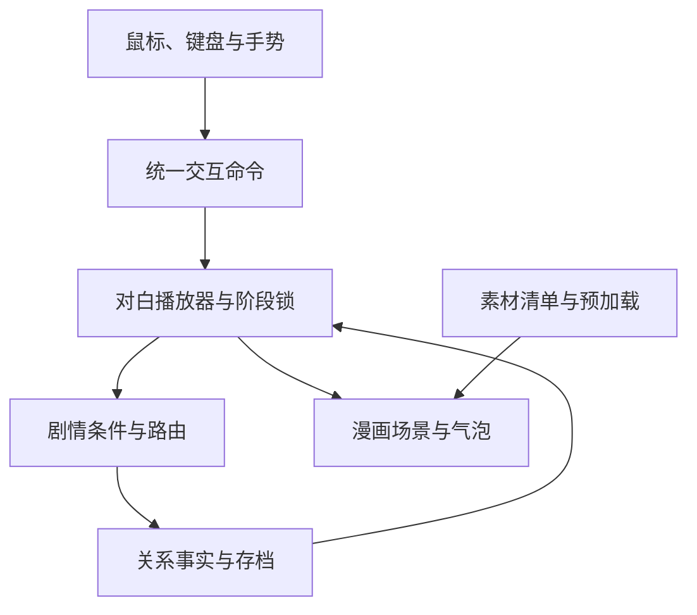

# 《后来呢》游戏架构

> 美术执行以 [最终画风确认](ART_DIRECTION_LOCK.md) 为准。用户已确认 Q 版淡彩细线手绘，覆盖本文对 Second Nature 旧画风的沿用描述。保留其交互与场景组织思路。

版本：2026-10-24，v1.1。依据：同目录完整分支剧本，以及本地 SECOND NATURE 当前实现。

## 1. 产品定位与范围

《后来呢》是以小五第一人称参与、小梦为另一位独立角色的漫画分支恋爱游戏。核心体验是观察人物与环境，逐句读对白，在关键时刻选择自己的回应，再经历选择带来的变化。

本期固定 33 个叙事节点、4 种结局。不同选项可以进入不同节点，也可以在同一背景下播放不同回答后重新交汇。每次游玩只显示实际走过的故事，不一次展示完整分支树。完整路线的长度不同，朋友线较短；不对玩家承诺固定 33 幕或固定游玩分钟数。

本设计交付阶段只写架构、剧情和素材规划。后续实现按章节进行，但不能把只有开头的原型称为完整游戏。

## 2. 与 SECOND NATURE 的关系

实际检查过的实现包括 `App.vue`、`ComicScene.vue`、`PinchButton.vue`、`gestureNavStore.ts`、`storyAssetService.ts` 和剧情类型。

| 当前实现 | 《后来呢》的处理 | 理由 |
| --- | --- | --- |
| Vue 3 + TypeScript + Pinia + Vite | 延用相同技术组合，创建独立项目 | 便于复用已有经验与手势服务 |
| MediaPipe 手势识别、坐标映射、捏合边沿 | 检查依赖后迁入独立服务 | 输入机制已具备基础，不必重做一套识别 |
| `PinchButton` 阻止原生 click/Enter/Space | 新写 `ActionButton`，接通原生点击和键盘，同时接收手势命令 | 直接复制会导致鼠标看得到按钮却点不动 |
| App 挂载即开启摄像头 | 改为主动开启手势；鼠标立即可用 | 摄像头权限不得成为阅读故事的前置条件 |
| 丢失手部跟踪触发剧情暂停 | 只隐藏手势光标或提示状态，保留鼠标操作 | 两种操作并存，手势失败不锁住游戏 |
| 固定数组和 `nextSceneIndex` | 改为节点 ID、条件路由及访问记录 | 剧情不是线性 17 幕，且会多路交汇 |
| 整张场景图 + 场景外长段 `storyText` | 拆为固定场景层、角色层、气泡层和选项层 | 支持一句一句对话、人物表情与局部更新 |
| 背包、垃圾去向、研究问卷和分类成绩 | 不迁入爱情状态模型 | 新游戏的状态是经历和关系事实 |
| 全屏淡出、时间地点字幕、淡入 | 沿用节奏，但仅在实际画面切换时使用 | 同一张图说话不反复黑屏 |
| `prepareArt` 图片加载缓存 | 保留思路，扩展为带变体和失效处理的素材清单 | 场景、人物、表情和背景版本远多于一张图 |

迁移只复制需要的源文件并保留其许可信息，不引用旧项目的 node_modules、不从旧游戏的 localStorage 读取存档。新包名建议 `hou-lai-ne`，浏览器标题为“后来呢”。依赖版本应从实际兼容的锁文件出发，首次安装后单独锁定。

## 3. 玩家流程

封面 → 新故事或继续 → 漫画对白 → 选择 → 对应回应 → 下一段或换场 → 结局收尾 → 已读回顾／重新开始。

封面提供“开始”“继续”“设置”。设置中提供手势开关、字体大小、音效与转场速度。鼠标不需要选模式；开启手势后鼠标继续有效。手势练习可随时打开，关闭后回到原进度。

正文显示当前章节、较小的时间地点、画面、当前气泡以及必要的选项。可打开暂停、对白记录和设置；正文不显示开发节点编号、隐藏变量、已走到哪种结局的预测。

## 4. 三种单位必须分开

| 单位 | 含义 | 示例 |
| --- | --- | --- |
| 故事节点 node | 一段有独立选项与路由的叙事 | S09、B02、B03 是三个节点 |
| 画面场景 stage | 同一地点、构图和人物站位的画面环境 | S09/B02/B03 可以共用桥边构图 |
| 对话步 beat | 一次推进显示的句子、动作或短字幕 | “你什么时候知道要代班的？” |

节点变化不必更换背景。S09→B02 时仅更新对白与姿态；S09→D01 才切换到房间通话场景。S14、B08、B09、B10 共用一类画面构图；三个月后的 B10 需要时间字幕和道具变化，但可继续使用已加载的背景，不重新请求或销毁整幅图。

“不刷新整个界面”在技术上指保留应用和场景组件实例、保持素材资源、局部更新对应 DOM。Vue 可以进行必要的响应式更新，不承诺浏览器完全没有重绘。

## 5. 系统拆分



| 模块 | 责任 | 不负责 |
| --- | --- | --- |
| StoryRepository | 加载版本化节点、台词、条件、素材引用 | 决定摄像头状态 |
| NarrativeEngine | 应用选择、选出唯一后继、生成本次对白队列 | 直接操作 DOM |
| DialoguePlayer | 逐句推进、播放回应、管理阶段与历史 | 临时修改台词里的故事事实 |
| StageRenderer | 绘制背景、人物、表情、道具与气泡 | 判断结局 |
| InputRouter | 把鼠标/手势统一成命令，防止一次操作执行两次 | 修改关系状态 |
| AssetManager | 解码预加载、缓存、失败重试、版本校验 | 一次性加载全游戏全部高清素材 |
| SaveRepository | 原子保存、恢复、版本迁移、导入校验 | 在恢复时重复执行上次选项效果 |
| EndingRegistry | 记录已真正读完的结局，支持回顾 | 向正在游玩的玩家剧透未见结局 |

## 6. 推荐目录结构

以下是后续实现的目标结构，当前设计包只包含 README、docs、references。

```text
后来呢/
  README.md
  docs/
    STORY_SCRIPT.md
    ARCHITECTURE.md
    SCENE_RENDERING.md
    SCENE_MANIFEST.json
    ACCEPTANCE.md
  references/second-nature-style.png
  public/art/
    backgrounds/
    characters/xiaowu/
    characters/xiaomeng/
    props/
    endings/
  src/
    App.vue
    main.ts
    components/
      ComicStage.vue
      CharacterLayer.vue
      DialogueBubble.vue
      NarrationCaption.vue
      ChoicePanel.vue
      ActionButton.vue
      TransitionOverlay.vue
      BacklogDialog.vue
      GestureCursor.vue
    data/
      story/nodes/
      story/conditions.ts
      art/manifest.ts
    domain/
      story/types.ts
      story/engine.ts
      story/validate.ts
      input/commands.ts
      input/gestureInterpreter.ts
      input/coordinateMapper.ts
    stores/
      narrativeStore.ts
      settingsStore.ts
      gestureStore.ts
    services/
      assetManager.ts
      saveRepository.ts
      handTrackingService.ts
      cameraService.ts
    styles/
      tokens.css
      stage.css
      dialogue.css
  tests/
    story-routes.test.ts
    story-memory.test.ts
    dialogue-resume.test.ts
    input-commands.test.ts
```

## 7. 数据模型与条件规则

剧本是权威内容，后续录入为结构化节点。SCENE_MANIFEST.json 目前只做场景索引，不能拿它直接替代含全部对白的 StoryNode。

```ts
type NodeId = string;
type Speaker = 'xiaowu' | 'xiaomeng' | 'classmate' | 'narrator';
type Phase = 'loading' | 'dialogue' | 'choosing' | 'response'
  | 'transition' | 'ending' | 'paused' | 'asset-error';

type Condition =
  | { op: 'eq'; key: string; value: string | boolean }
  | { op: 'all' | 'any'; items: Condition[] }
  | { op: 'not'; item: Condition };

interface Beat {
  id: string;
  kind: 'speech' | 'thought' | 'message' | 'narration' | 'action';
  speaker?: Speaker;
  text?: string;
  when?: Condition;
  anchor?: string;
  expression?: string;
  pose?: string;
  propChanges?: Array<{ id: string; visible: boolean }>;
}
interface Choice {
  id: string;
  label: string;
  effects: Array<{ key: string; value: string | boolean }>;
  response: Beat[];
  routes: Array<{ when?: Condition; to: NodeId }>;
}
interface StoryNode {
  id: NodeId;
  chapter: string;
  stageId: string;
  stageVariantRules: Array<{ when?: Condition; variant: string }>;
  beats: Beat[];
  choices: Choice[];
  terminalEnding?: 'E01' | 'E02' | 'E03' | 'E04';
}
```

这是架构草案。实现时 `key` 应收紧到合法变量名联合类型，值使用对应枚举，防止把 `trust` 拼成其他字段。条件只允许声明式运算，不使用 eval，不执行文本里带来的任意表达式。

显式事实包括：是否一起听过歌、笔记上的画是哪一种、是否正式交往、出国信息是否说清、失约是否已经用实际行动修复、是否共同制定计划、当前年龄阶段、分手发生在何时、同城后是否同居。不同故事事实不能压缩成一个好感值。

选择提交时先读取当前有效版本，原子执行：选项验证 → 应用效果 → 选出对白变体 → 固定回应队列和唯一后继 → 保存提交记录 → 开始播放回应。路由判断用应用本次效果后的状态；同一优先级多条条件同时成立属于内容错误，不能随机选择。所有有条件路由必须有可证明覆盖的条件或明确默认项。

### B10 的确定性示例

- 只有共同计划已成立的路线进入 B10。
- 选 A 后，透明问题已处理且履约已经兑现／修复 → D03。
- 选 A 后，任一问题仍未处理 → B11。她需要持续行动，而不是一句保证。
- 选 B → D02；选 C → D01。
- B11 A → D03；B11 B → D01；B11 C → D02。

## 8. 对白播放状态机

进入节点时只解析一次本次入口对白。阅读阶段显示当前 beat；点击画面空白处、气泡或“继续”可以推进一句。选项阶段只接受明确选择，点击画面其他位置不会自动选第一项。

选项确认后隐藏选项并播放对应回答。回答未读完，不跳场、不提前显示下一组选项。回答结束时，如果下一节点共用 stage，直接切换队列；如果需要换画面，则启动转场。

默认整句出现，不用强制打字机拖慢阅读。若日后提供打字机选项，第一次点击补全本句、下一次才推进；手势和鼠标行为一致。

结局节点同样有最后一个选择。播放完其回应及共同收尾后才记录 endingCompleted。解锁结局不是进入 E01 的瞬间，否则存档恢复可能直接跳过结尾。

“回看对白”只是只读日志，不修改选择或故事状态。“从这里重选”应从明确检查点创建新分支存档并重演之后状态，不能留下旧路线的回忆、道具、已选项或关系变量。

## 9. 场景渲染与图层

舞台采用固定逻辑画布 1600×900，按容器等比缩放并留边；素材交付建议 1920×1080。人物和气泡锚点用归一化坐标，不用只适配一台显示器的像素位置。

从底到顶为：背景 → 环境点缀 → 角色 → 关键道具 → 气泡/短旁白 → 选择/菜单 → 转场遮罩。黑屏转场时锁住底层输入；关闭菜单后恢复原来的 beat。

`ComicStage` 的 key 不使用 lineId 或当前句子索引。背景只依赖 stageId 和背景变体；`DialogueBubble` 只订阅当前句子，`CharacterLayer` 只更新说话者高亮、表情和姿态。背景解码结果复用，逐句点击不触发完整图片重新下载、路由重挂载或 window.location 操作。

同一人物在同一场内换表情时必须保持身体位置、头部比例和视线方向。若新表情素材未就绪，先保持原表情，不闪白、不展示缺图符号。需要显著走位或拥抱时使用预设姿态变体，不用整图缩放冒充人物动作。

多地点视频采用漫画分格场景：小五在左、手机中的小梦在右。气泡尾巴指向各自分格的人物或手机，不把远程电话误画成同处一室。广播节目文字也要明确来自手机。

### 气泡布局

- 桌面中文正文默认 24px，可选 22/24/28px；选项 20—24px，响应式下保证不被压成小字。
- 通常每句 10—30 个汉字。最长句允许自然换成 2—3 行；需要更多时在脚本中拆成两个 beat，而不是缩小字号。
- 气泡有说话者名字或稳定识别标志，尾巴与角色对应。不能只靠颜色辨认人物。
- 每幕预先标注 2—3 个气泡安全区域，避开眼睛、手、耳机线、信件等关键道具。
- 选项在舞台下方独立区域显示，人物画面尺寸不因选项出现而跳动；可预留选择区域高度。
- 小屏采用竖向布局：舞台在上，当前气泡靠人物对应侧排列于下，保留人物小头像/名字。不要把整幅 16:9 图和全部文字同时缩成微缩图。
- 主文案不是画在插画里，所有对白用 HTML 文本渲染，便于清晰显示、调整字体与访问辅助工具。

## 10. 鼠标与手势共存

统一命令至少包括 Advance、SelectChoice(choiceId)、OpenMenu、CloseMenu。每个命令携带 source、actionId 和 narrativeRevision。实际可执行性由播放器当前阶段统一判断，而不是两套输入各自改状态。

鼠标原生 click、键盘 Enter/Space 和手势的新捏合边沿都调用同一按钮处理函数。不要在手势处理里再模拟 DOM click 后又直接提交一次。菜单、选项按钮阻止向舞台的冒泡，避免选择后顺便跳过第一句回应。

同一捏合必须松开后才能再次触发，跨场景、跨菜单和选项出现时重新等待释放。此等待只约束手势，不能使鼠标失效。交互路由用 actionId 去重和短暂重入锁，保留正常逐句点击的速度；快速双击不能越过选择、回应或转场边界。

摄像头关闭、拒绝权限、模型下载失败或手暂时离开画面，均不丢失剧情、不强制暂停、不禁止鼠标。只展示短状态说明和“重试手势”。退出手势时停止摄像头轨道和检测循环，不录制或上传视频。

## 11. 转场与预加载

默认流程：完成当前回应 → 预加载/解码确定后继的必要素材 → 淡出约 350ms → 短时间地点字幕 → 更换场景 → 淡入约 450ms。时间是初始设计值，最终以阅读感受调整。

加载较慢时保持当前完整画面并显示轻量加载状态，不先切成一片黑让玩家等待。提供重试和暂用简化背景继续的选项；简化版本必须保留角色称呼、对白、选项和正确剧情，不静默假装完整画面已加载。

进入选项段时预取最可能的 1—2 个后继背景，确定选择后优先加载实际后继。不一次解码 29 张高清图；LRU 控制解码驻留为当前场景、相邻场景和必要角色。原图与导出 webp 分开保存，逐图评估线稿边缘和透明角色质量。

素材 URL 带构建版本，发布替换图片不会混用旧缓存。AssetManager 的失败 Promise 必须可清除重试，不能把一次失败永久缓存为不可用。

“减少动态效果”开启时取消不必要的光标装饰、缓动和长黑屏，仍保留明确的场景变更与文字可读性。

## 12. 存档与恢复

首版浏览器本地保存即可。建议 IndexedDB 保存结构化存档与多槽位，localStorage 只放小型偏好与最近槽位引用。若实现先使用 localStorage，也要处理容量与写入失败，不允许提示保存成功但实际没有写入。

存档包含：schemaVersion、storyVersion、slotId、当前 nodeId、stageVariant、phase、beatId/已解析队列、relationshipFacts、已提交选择事件、visitId、叙事 revision、固定后继、已读日志、结局收尾进度，以及设置。设置与剧情事实分别存储。

在选项提交时先原子保存，再显示回应；每次推进后更新当前位置。刷新时恢复到当前回应句，而不是重新应用选择效果。转场中刷新时恢复到已提交的目标节点开头或保存的过渡阶段，不能丢失目标或跳过两个节点。

保存失败时继续保留内存状态，明确提示并允许重试/导出存档。导入存档要校验版本、节点、变量、类型和大小；不把任意输入当代码执行。旧故事版本不能悄悄按新路由重算，应迁移明确可映射的字段或让玩家选择从最近可兼容节点继续。

多标签页用槽位写入版本检测防止互相覆盖，第二个标签页发现存档已变化时提示重新载入或另存。切换手势开关不改变故事版本，也不重置读到的句子。

## 13. 章节与结局

| 章节 | 内容 | 节点范围 |
| --- | --- | --- |
| 第一章：坐近一点 | 相识、同桌、试音、球赛与雨夜 | S01—S06 |
| 第二章：没说完的话 | 申请、表白、出国与选择 | S07—S10、B01—B03；F01 为朋友分支 |
| 第三章：你的明天 | 异地日常、重要节目、失约与修复 | S11—S13、B04—B07 |
| 第四章：后来怎么过 | 工作去向、试行、真实生活 | S14、B08—B11、D03 |
| 尾声 | 圆满、耗尽后的重逢、没有开始、坦诚告别 | D01/D02 与 E01—E04 |

章节进度可以显示章节标题及本章当前段落，不显示“第 24/33 幕”误导玩家以为每条路线都一样长。已完成后可以查看本次选择和看过的回忆，不默认亮出未解锁结局的判定条件。

## 14. 实施顺序

1. 定稿人物母设定和三张风格样片：S01 看台、S08 面馆、S12 桌前/直播画中画。先确认角色辨识、气泡留白和场景丰富度，再批量绘制。
2. 搭建独立项目及对白播放器，用 S01/S02/S08/S09 做完整的“对白→选项→回应→同背景分支/换场”切片。
3. 录入全部 33 节点与变量，先用有辨识度的分镜草图走通所有路线。占位图需明确标记，不能把同一张背景当最终交付。
4. 完成鼠标和键盘，再接通现有手势服务。加入权限失败退路和两种输入并存验证。
5. 分批替换 29 张基础背景交付、人物表情与分支道具，按 SCENE_RENDERING.md 核对每个节点。
6. 完成断点恢复、结局记录、回看和检查点重选；验证时间线与未发生事件不被回忆。
7. 按 ACCEPTANCE.md 实际试玩与构建检查，再决定部署。当前文档不声称完成代码、插画生成或上线。
