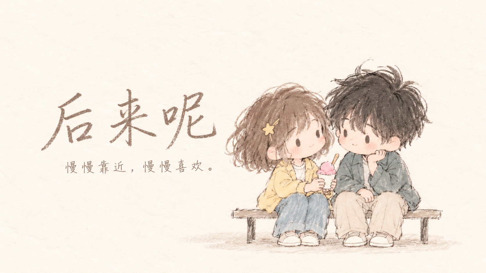

# 后来呢 · Later On

当前全屏阅读版本包含414个剧情镜头。粗蜡笔风格逐幅重绘已接入414／414幅独立整图，剧情镜头和封面均已完成替换；准确进度见 Later_On_Architecture_Package/docs/INDIVIDUAL_ART_PROGRESS.json。

新接入原画为1672×941，每幅单独生成；旧九宫格每格约557×314。不能将整张图集尺寸或简单放大的图片当作单幅高清。人物与蜡笔笔触要求清楚，背景通过省略细节保持朦胧。每次重新对照最初用户样图，并检查人物、笔触与道具；不使用连续生成图作为滚动风格参考。

**慢慢靠近，慢慢喜欢。**

[在线试玩 →](https://lateron-purelove.netlify.app/)



借一支笔，顺一段路，分享一杯冰淇淋。小五和小梦的故事，从这些很小的事开始。

你会陪他们走过同桌的午后、放学后的长椅、第一次认真说出口的喜欢，也会遇到异地、失约和重新靠近。那些嘴上装作不在意、心里却反复记起的瞬间，会慢慢写成属于这一次选择的后来。

## 这是一款什么游戏？

《后来呢》是一款中文 Q 版手绘互动恋爱故事。全部剧情镜头和封面已按用户指定样图替换为粗蜡笔手绘：人物清楚、笔触粗糙，背景简化朦胧。每幅剧情画面均使用独立原画。你扮演小五，逐句阅读，在重要时刻选择自己想说的话。

- **39 个剧情节点，4 种结局。** 表白前有完整的相处过程；选择没有好感分数，也没有倒计时。
- **把心动画出来。** 递笔时碰到的指尖、同一杯冰淇淋、公交车上借出的肩膀、机场的拥抱，都有对应的动作分镜。
- **听见没说出口的话。** 对白、旁白和两个人的心声交替推进，保留那些犹豫、停顿与小小的期待。
- **配乐跟着故事走。** 五段原创钢琴风合成旋律，分别陪伴轻快、心动、温柔、想念和失落的时刻，场景间柔和切换。
- **像翻一本手绘本。** 暖白纸面、淡彩气泡和简洁选项，内置「站酷快乐体」中文字体，24 / 28 / 32px 可调。
- **一屏慢慢读。** 阅读界面覆盖窗口，插画在暖白画布中按原始尺寸居中，对白与选项位于下方；小窗口中的长文字可在卡片内滚动。

## 怎么玩

1. 点击上方的 **在线试玩**，在电脑浏览器中打开游戏。
2. 点击 **翻开故事**。配乐会在这次点击后开始，也可以随时静音。
3. 点击气泡或画面显示整句，再点击继续下一句。场景始终显示完成的静态插画，没有人物动画或动画等待。空格、Enter 同样可用。
4. 选项出现后，选择你想说的话。可以停下来想一会儿。
5. 进度自动保存在当前浏览器。通过 **对白记录** 回看，通过 **这一路** 从某次选择另开分支。

设置中可调字号、直接显示整句、开启或关闭配乐，以及主动开启摄像头手势。手势为可选操作：食指移动，拇指与食指捏合点击；鼠标与键盘始终可用。

存档可从暂停菜单导出或导入 JSON。剧情 2.0 加入了新的相处段落，旧版存档不能直接续读；已经解锁的结局会保留。

## 本地运行

```powershell
npm install
npm run dev
```

打开终端显示的地址，默认是 `http://127.0.0.1:5175`。

```powershell
npm run story:compile
npm run check
npm run preview
```

- `npm run check`：检查剧情路线、存档、静态分镜、文字显示、音乐及素材，再进行类型检查和生产构建。
- `npm run build`：构建静态发布目录 `dist`；可将其部署到 Netlify 等静态托管平台。
- 剧本：`Later_On_Architecture_Package/docs/STORY_SCRIPT.md`。
- 分镜绑定：`src/domain/presentation.mjs`。
- 静态场景说明：[`ANIMATION.md`](Later_On_Architecture_Package/docs/ANIMATION.md)。
- 当前进度与未完成项：[`IMPLEMENTATION_STATUS.md`](Later_On_Architecture_Package/docs/IMPLEMENTATION_STATUS.md)。
- 原创配乐生成：`python scripts/compose-music.py`。
- 原版剧本备份：`Later_On_Architecture_Package/docs/STORY_SCRIPT.v1.1.md`。

游戏使用 Vue 3、TypeScript、Pinia 和 Vite；剧情和进度在浏览器中运行，无需后端服务。摄像头手势需要 HTTPS 或 localhost。真实摄像头识别效果仍需在实际设备上验收。

## 制作与许可

插画由 AI 辅助生成。剧情共有414个静态镜头，粗蜡笔独立重绘已全部完成，封面也已接入。已接入文件与完成数量以 src/data/individualArt.json 和 INDIVIDUAL_ART_PROGRESS.json 为准；414幅剧情镜头均已注册，封面使用 art/individual/crayon-cover.png。图片按剧情直接切换，美术入口为 src/data/artStyle.mjs。

配乐由项目中的原创旋律与合成脚本制作，没有使用商业歌曲录音。中文字体为 ZCOOL KuaiLe（站酷快乐体），按 SIL Open Font License 使用，许可见 `public/fonts/OFL.txt`。手势模块保留原项目许可，见 `THIRD_PARTY_LICENSE_SECOND_NATURE.txt`。
