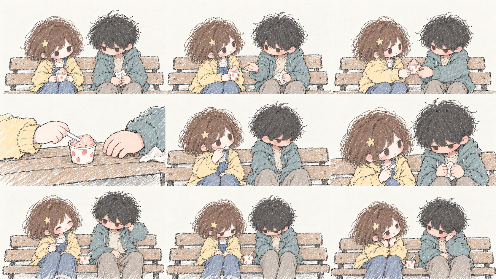

# 后来呢 · Later On

**慢慢靠近，慢慢喜欢。**

[在线试玩 →](https://lateron-purelove.netlify.app/)



*当前粗铅笔淡彩画风与连续分镜预览；游戏内逐格显示，封面使用右下角那一格。*

借一支笔，顺一段路，分享一杯冰淇淋。小五和小梦的故事，从这些很小的事开始。

你会陪他们走过同桌的午后、放学后的长椅、第一次认真说出口的喜欢，也会遇到异地、失约和重新靠近。那些嘴上装作不在意、心里却反复记起的瞬间，会慢慢写成属于这一次选择的后来。

## 这是一款什么游戏？

《后来呢》是一款中文 Q 版手绘互动恋爱故事。粗糙铅笔线、蜡笔淡彩和留白，只勾勒小五与小梦身边的小世界。你扮演小五，逐句阅读，在重要时刻选择自己想说的话。

- **39 个剧情节点，4 种结局。** 表白前有完整的相处过程；选择没有好感分数，也没有倒计时。
- **把心动画出来。** 递笔时碰到的指尖、同一杯冰淇淋、公交车上借出的肩膀、机场的拥抱，都有对应的动作分镜。
- **这一次，人物也会动。** 头部、手臂、身体和双腿分层控制：伸手、捡笔、靠近、牵手、拥抱与松开都有连续动作。每个选项也有自己的姿态和道具回应。
- **小动作也慢慢画出来。** 全剧 149 处具体动作有分阶段呈现：递杯会等对方接稳，伞柄会在两人之间让来让去，尝完再放下勺子，挂电话前也会留一小段停顿。
- **让画面轻轻动起来。** 靠近时镜头缓缓推进，热水冒着淡淡蒸汽，雨线落下、公交窗边光影掠过。打开菜单时暂停，设置中可关闭动态效果。
- **听见没说出口的话。** 对白、旁白和两个人的心声交替推进，保留那些犹豫、停顿与小小的期待。
- **配乐跟着故事走。** 五段原创钢琴风合成旋律，分别陪伴轻快、心动、温柔、想念和失落的时刻，场景间柔和切换。
- **像翻一本手绘本。** 暖白纸面、淡彩气泡和简洁选项，内置「站酷快乐体」中文字体，24 / 28 / 32px 可调。
- **一屏慢慢读。** 气泡出现在人物附近，文字逐字出现，选项在画面下方展开，游玩页面不需要上下滚动。

## 怎么玩

1. 点击上方的 **在线试玩**，在电脑浏览器中打开游戏。
2. 点击 **翻开故事**。配乐会在这次点击后开始，也可以随时静音。
3. 点击画面或气泡，先显示当前整句；动作还在播放时，再点可直接看到动作完成的姿势，随后点击进入下一句。空格和 Enter 同样可用。
4. 选项出现后，选择你想说的话。可以停下来想一会儿。
5. 进度自动保存在当前浏览器。通过 **对白记录** 回看，通过 **这一路** 从某次选择另开分支。

设置中可调字号、直接显示整句、开启或关闭配乐，以及主动开启摄像头手势。手势为可选操作：食指移动，拇指与食指捏合点击；鼠标与键盘始终可用。

存档可从暂停菜单导出或导入 JSON。剧情 2.0 加入了新的相处段落，旧版存档不能直接续读；已经解锁的结局会保留。

## 本地运行

```powershell
npm install
npm run dev
```

打开终端显示的地址，默认是 `http://127.0.0.1:5175`。

```powershell
npm run story:compile
npm run check
npm run preview
```

- `npm run check`：剧情路线、存档、分镜、逐字显示、音乐及字体检查，再进行生产构建。
- `npm run build`：构建静态发布目录 `dist`；可将其部署到 Netlify 等静态托管平台。
- 剧本：`Later_On_Architecture_Package/docs/STORY_SCRIPT.md`。
- 分镜绑定：`src/domain/presentation.mjs`。
- 分镜动态：`src/domain/motion.mjs` 与 `src/sketch.css`。
- 人物动作与选项回应：`src/domain/choreography.mjs`、`src/domain/puppetTimeline.mjs`；细节见 [`ANIMATION.md`](Later_On_Architecture_Package/docs/ANIMATION.md)。
- 当前进度与未完成项：[`IMPLEMENTATION_STATUS.md`](Later_On_Architecture_Package/docs/IMPLEMENTATION_STATUS.md)。
- 原创配乐生成：`python scripts/compose-music.py`。
- 原版剧本备份：`Later_On_Architecture_Package/docs/STORY_SCRIPT.v1.1.md`。

游戏使用 Vue 3、TypeScript、Pinia 和 Vite；剧情和进度在浏览器中运行，无需后端服务。摄像头手势需要 HTTPS 或 localhost。真实摄像头识别效果仍需在实际设备上验收。

## 制作与许可

插画由 AI 辅助生成，人物与美术方向由项目设定确定。当前使用 9 张粗铅笔淡彩图集，共 81 格，另有透明人物部件素材，通过头部、身体、手臂与双腿的关节插值实现连续动作。每个选项绑定对应的姿态、道具和双人／异地／单人画面；普通对白保留当前姿势，环境继续采用留白与轻量勾勒。

配乐由项目中的原创旋律与合成脚本制作，没有使用商业歌曲录音。中文字体为 ZCOOL KuaiLe（站酷快乐体），按 SIL Open Font License 使用，许可见 `public/fonts/OFL.txt`。手势模块保留原项目许可，见 `THIRD_PARTY_LICENSE_SECOND_NATURE.txt`。
